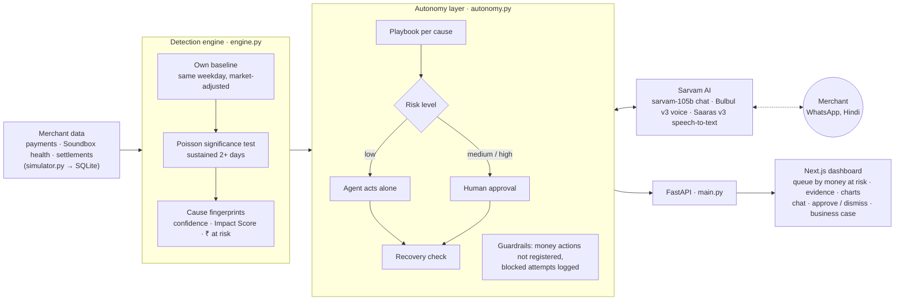

# MerchantPulse AI

**An autonomous AI teammate that spots Paytm merchants about to slip, finds out why, talks to them in Hindi, fixes simple problems itself, brings in humans only when needed, and checks that the merchant actually recovered.**

Paytm Build for India AI Hackathon · Track 3: Autonomous AI Teammates · Team: Ashutosh Yadav, Abhishek Dwivedi

> *Paytm can't call millions of merchants. MerchantPulse tells it exactly whom to call, and why.*

---

## The problem

Paytm has about **1.5 crore subscription merchants** (Soundbox and card machines). When something goes wrong, they rarely complain:
- the Soundbox goes offline,
- UPI payments start failing,
- or settlements arrive late.

Customers then quietly start paying on another app's QR code. With PhonePe at ~46% and Google Pay at ~35.6% of UPI (Paytm ~7%, July 2025), a merchant who leaves is hard to win back.

Existing alerts fire on every dip, so support teams drown in noise, and an alert only says *something* is wrong. It doesn't say why, fix anything, or check that the fix worked.

## What MerchantPulse does

```
 Detect  →  Diagnose  →  Talk  →  Act  →  Verify
```

| Step | What happens |
|---|---|
| **Detect** | Compares each merchant with **their own normal** (same weekday last week, market-adjusted) and flags only problems that are statistically significant and last 2+ days |
| **Diagnose** | Matches the evidence to a cause fingerprint: device fault, SIM / network, settlement delay or possible app switch, with a confidence score and an **Impact Score** |
| **Talk** | Messages the merchant on a WhatsApp-style chat in Hindi/Hinglish, by text and voice (Sarvam AI) |
| **Act** | Does low-risk fixes itself; medium- and high-risk actions wait for a human. Money actions don't exist for the AI |
| **Verify** | After a fix, checks that the merchant's sales are back to normal (≥85% of their baseline) |
| **Stay silent** | If the whole market dips (a festival), it sends **0 messages** |

## Results on the demo data

500 simulated merchants × 30 days, "today" = day 10, problems planted on day 8, plus 20 noisy decoys.

| | |
|---|---|
| Merchants scanned → looked unusual → **need action** | 500 → 333 → **4** |
| One-off blips ignored / festival dip, stayed silent | 51 / 278 (0 messages sent) |
| False alarms avoided | **329** (0 false alarms on normal merchants and decoys) |
| Caught earlier than a "volume fell 30%" alert | **3 days** |
| Payment volume protected (after approving one fix) | **₹1,27,300** |
| Recovery verified | Sharma **104%**, Bansal **99%** of their normal |
| Normal failure rate in the simulation | 0.78% (NPCI real-world: ~0.8%) |
| Sarvam chat reply time | ~0.5 s |

### The cases
| Merchant | Cause | What the agent did |
|---|---|---|
| Sharma General Store | Device fault: failures 0.9% → 5.8% (9 vs ~1 expected), Soundbox offline 3/3 days, network fine | Sent restart steps → still failing → **proposed a Soundbox replacement** → human approved → recovered to 104% |
| Bansal Kirana | Weak SIM / network | **Fixed it alone** (low risk), recovered to 99% |
| Raj Tea Stall | *Possible* app switch (capped at 70%) | Merchant asked for a fee waiver → **blocked in code**, logged, handed to a person |
| Noida Fresh Mart | Settlement delay: 48 h instead of 2 h | Ticket to the settlements team, waiting for approval |
| Festival day | 278 merchants dipped together | **Did nothing on purpose** |

---

## Architecture



### Design principles
- **The LLM writes the words; code decides the actions.** Sarvam suggests a reply and an intent, but the action registry, risk levels and playbooks are deterministic Python.
- **Safety intents are checked twice.** Money requests and opt-out ("STOP") are caught by both the LLM and a keyword rule; either one triggers the safe path.
- **Money actions don't exist.** Fee waivers, refunds and offers are not registered actions, so no prompt can trigger them. Medium-risk actions refuse to run without human approval. Every blocked attempt is recorded.
- **Always a reply.** If Sarvam is slow or down, backup Hindi templates answer, so the merchant is never left hanging.
- **Honest numbers.** An app switch is only ever *possible* (capped at 70%), because we can't see other apps' data. "₹ leaking" is labelled an estimate. The Impact Score is a risk score, not a measured loss.
- **Cheap at scale.** The plain-Python engine scans every merchant; only flagged ones (4 of 500 here) reach the LLM. Cost grows with problems, not with merchants.

### Detection in detail
1. **Baseline:** each merchant's own first week (days 1–7) vs the recent days.
2. **Market adjustment:** each day's volume is compared with the same weekday last week, divided by the market-wide median change, so a festival dip cancels out.
3. **Significance:** a Poisson tail test (p < 0.001) on failed payments. "9 failures when ~1 was expected" is flagged; 2 failures in a tiny shop is not.
4. **Persistence:** the problem must last at least 2 days.
5. **Cause fingerprints:** device fault (failures + Soundbox offline + network fine), SIM / network (weak signal), settlement delay (slow settlements), possible app switch (fewer payments while bill size, failures and device are normal). Confidence = share of signals that agree.

### Merchant Impact Score (0–100)
How hard the business is hit, built from three visible parts:

| Part | Points |
|---|---|
| Can they take payments and get paid? (failures, Soundbox offline, settlement delay) | 45 |
| Paytm payments below their own normal | 35 |
| Business at stake (size of the merchant) | 20 |

Example: Sharma 66 (High), Noida Fresh Mart 65 (High), Raj 37 (Medium). Each case also shows plain-language lines such as *"Soundbox offline on 3 of the last 3 days"* and *"Settlement status is normal."*

### Business case (estimate)
The dashboard includes a panel with adjustable assumptions. With cautious defaults, the net value is **≈ ₹19.9 crore a year at Paytm's scale, ~70× the AI cost**:

| Line | Value per year |
|---|---|
| Revenue kept | ₹17.3 Cr (≈6,000 merchants saved a month) |
| Support cost saved | ₹2.9 Cr |
| AI cost | −₹29 L |

These rest on assumptions: 20% would leave, 25% saved, ₹200/month revenue per merchant, ₹80 per human-handled case. A one-city pilot with a control group would measure the real numbers.

---

## Tech stack

| Layer | Tech |
|---|---|
| AI | **Sarvam AI**: `sarvam-105b-conversations` (Hindi/Hinglish chat), Bulbul v3 (text-to-speech), Saaras v3 (speech-to-text) |
| Backend | Python 3.11, FastAPI, Pandas, NumPy, SQLite |
| Frontend | Next.js 15, TypeScript, Tailwind CSS v4, Recharts |

## Project structure

| Path | What |
|---|---|
| `backend/simulator.py` | 500 synthetic merchants × 30 days: payments, Soundbox health, settlements, planted problems and decoys |
| `backend/engine.py` | Detection and diagnosis, festival filter, Impact Score, ₹ at risk |
| `backend/autonomy.py` | Action registry and risk levels, guardrails, playbooks, chat handling, recovery check, impact numbers |
| `backend/sarvam_client.py` | Sarvam chat, TTS and STT with a disk cache for voice |
| `backend/stories.py` | The 5 planted cases and backup Hindi scripts |
| `backend/main.py` | FastAPI endpoints |
| `backend/test_*.py` | Tests: simulator, engine (graded against hidden ground truth), autonomy and guardrails, Sarvam |
| `frontend/src/` | Dashboard: case queue, case detail, WhatsApp-style chat with voice, charts, business case |
| `docs/API_CONTRACT.md` | JSON shapes of every endpoint |
| `start-demo.ps1` | One-command start for Windows |

### API
| Method | Path | What |
|---|---|---|
| POST | `/api/scan` | Run the agent on all merchants |
| GET | `/api/cases` · `/api/cases/{id}` | Case queue · full case (evidence, series, chat, proposal, recovery, impact) |
| POST | `/api/cases/{id}/chat` | Merchant message → agent reply, intent, action taken |
| POST | `/api/cases/{id}/decision` | Human approve / dismiss → recovery result |
| GET | `/api/impact` | Volume protected, days earlier, auto-resolved, false alarms avoided |
| POST | `/api/voice/tts` · `/api/voice/stt` | Hindi voice in and out |
| POST | `/api/reset` | Restart the demo |

---

## Run it

Needs Python 3.11+ and Node 20+.

**Setup (once)**
```powershell
cd backend
python -m venv .venv
.\.venv\Scripts\pip install -r requirements.txt
copy .env.example .env        # then paste your Sarvam key into .env (never commit it)
cd ..\frontend
npm install
```
Without a Sarvam key, everything still runs: the agent uses backup Hindi replies and voice is off.

**Backend** (terminal 1)
```powershell
cd backend
.\.venv\Scripts\activate
uvicorn main:app --port 8000
```
API docs: http://localhost:8000/docs

**Frontend** (terminal 2)
```powershell
cd frontend
npm run dev
```
Open http://localhost:3000 and press **▶ Run agent**.

**Tests** (from `backend` with the venv active)
```powershell
python test_simulator.py; python test_engine.py; python test_autonomy.py; python test_sarvam.py
```
`test_sarvam.py` needs the key.

---

## Data note
The demo uses **simulated data**, because real Soundbox and payment logs are internal to Paytm. The simulation is calibrated to public figures: the 0.78% normal failure rate matches NPCI's ~0.8% UPI technical decline rate. The engine never reads the hidden ground truth; the tests use it to grade the engine.

## Roadmap
- Connect real Soundbox device data, UPI logs and settlement data (hourly scans)
- Learn from outcomes: which fixes worked, to improve the diagnosis and the first fix
- Shared-problem detection: one faulty Soundbox batch or tower outage → one fix for many merchants
- An uplift model: prioritise merchants where contact actually changes the outcome
- WhatsApp Business API, outbound voice calls in more Indian languages, CRM / ticketing integration
- Compliance: consent and opt-out (DPDP Act), personal data hidden from the LLM, data kept in India
